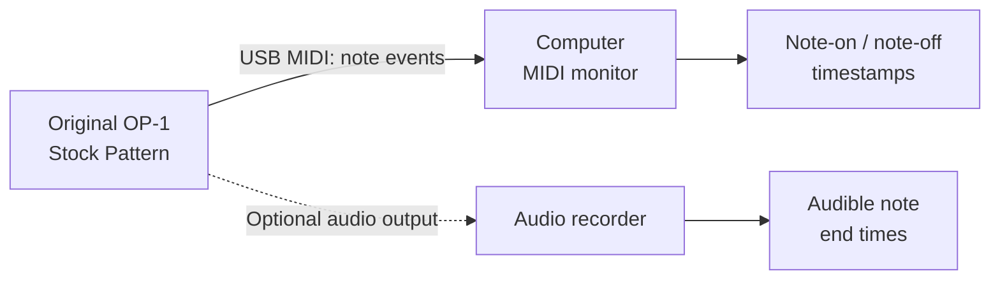

# Original Teenage Engineering OP-1: Pattern Sequencer Technical Research

> **Scope:** The **original Teenage Engineering OP-1**, **not** the later OP-1 Field.
>
> This document preserves the research response from the conversation, with its diagrams converted into portable Markdown (text diagrams and Mermaid), and its citations presented as direct source links. Where the available evidence does not establish an implementation detail, that uncertainty is stated explicitly.

I've located the original OP-1 operator's manual, Teenage Engineering's updated documentation, a contemporary *Sound on Sound* review, and particularly relevant discussions from OP-1 owners.

The important distinction is between **what the Pattern sequencer stores**, **how it triggers notes**, and **how the selected sound engine responds**.

## 1. Key findings

| Question | Finding |
|---|---|
| Pattern length | 16 steps maximum, with adjustable playback length and position |
| Polyphonic sequencing | Yes. Multiple different notes can occupy the same step |
| Maximum simultaneous notes | Depends on the instrument's voice limitations; not specified independently for Pattern |
| Individual note lengths | No documented per-note length control in Pattern |
| What determines audible duration? | Note gate behavior, synth/drum envelope, sample playback mode, and possibly voice stealing |
| Can notes overlap across steps? | Potentially, depending on engine and envelope behavior |
| Does Pattern support synths and drums? | Yes, with separate sequencer memories |
| Can Pattern chain multiple patterns? | No native pattern-chain feature is documented |

**The central finding:** Pattern is much closer to a 16-step **trigger sequencer** than to a full MIDI piano-roll editor. It stores which notes should be triggered at each step, without exposing the note-duration editing available in other sequencers.

That interpretation is consistent with [Teenage Engineering's official sequencer documentation][official-sequencers], [the Pattern control reference][official-reference], and historical user reports.

The distinction matters because a sound can continue after its step has passed, without the sequencer necessarily sustaining that note's gate.

## 2. Polyphony: what happens when multiple notes trigger?

The original OP-1 supports **up to six voices of synth polyphony**, as documented in contemporary coverage. However, this is a limitation of the sound-generation system, not a rule that Pattern permits only six notes to be entered into a step.

For example, suppose you program the following notes:

**Example: a polyphonic Pattern sequence**

```text
Step:  01 02 03 04 05 06 07 08 09 10 11 12 13 14 15 16
C4:     ●           ●           ●
G3:     ●                       ●           ●
E3:     ●           ●           ●           ●
C3:     ●                       ●
```

*Illustrative 16-step pattern with a four-note chord on steps 1 and 9, plus smaller voicings elsewhere. This is not a screenshot of the OP-1.*

The four-note chord can sound simultaneously when the active synthesizer is configured for sufficient polyphony. A [contemporary *Sound on Sound* review][sos-review] explicitly describes Pattern as suitable for polyphonic keyboard parts as well as drum parts.

### Synth polyphony versus sequencer polyphony

These are separate concepts:

- **Sequencer polyphony:** How many notes can be scheduled at the same instant.
- **Engine polyphony:** How many simultaneously sounding voices the engine can sustain.
- **Voice stealing:** What the instrument does when new notes arrive while its available voices are already occupied.

For the original OP-1, the synthesizer offers four play modes: **Poly, Mono, Legato, and Unison**. Select the mode from the synthesizer envelope screen (`T2`, then hold `SHIFT`). Teenage Engineering documents these modes in the [original synthesizer guide][official-synth].

A six-voice engine receiving seven overlapping notes cannot preserve seven independent sounding voices indefinitely. Some voice must be rejected, replaced, or otherwise handled by the engine.

I haven't found official documentation specifying the precise voice-stealing algorithm or whether every engine has exactly the same effective voice count.

One additional consideration: **the OP-1 is monotimbral during live synthesis**. Pattern does not let you assign one synth preset to each row. You have one active synth sound or drum kit. You can build multiple independent layers by recording passes to the four-track tape, but that's a separate recording process.

## 3. Note duration: the crucial distinction

A note has at least three useful time measurements:

1. **Trigger time:** The moment a note-on event occurs.
2. **Gate duration:** The interval between note-on and note-off.
3. **Audible duration:** How long the resulting voice remains audible, including its decay and release.

**How gate duration differs from audible duration**

```text
Time ─────────────────────────────────────────────────────────►

Steps:       |   1   |   2   |   3   |   4   |   5   |   6   |
Trigger:     ●
Gate:        ████████┐
                    └─ note-off

Amplitude:       /\
                /  \____
               /        \________
              /                  \________________

              ↑           ↑
          note-on     release tail continues beyond note-off
```

*Conceptual example only. The gate width is illustrative, not a measured OP-1 timing value.*

The original OP-1's Pattern sequencer does not provide an adjustable note-length parameter. In contrast, the [original OP-1 sequencer documentation][official-sequencers] explicitly describes extending notes across steps in **Endless**, and setting a global note length of **1–64 ticks** in **Arpeggio**.

That difference is consequential: turning up an envelope's release may make a Pattern note sound longer, but it does **not** necessarily mean the gate is held longer.

### How the sound engine changes the result

| Sound type | Main duration controls |
|---|---|
| Synth engine (FM, Pulse, Digital, etc.) | ADSR envelope, play mode, engine-specific behavior |
| Synth sampler | Sample boundaries, playback/loop behavior, ADSR envelope |
| Drum sampler | Sample in/out points, per-key playback mode, dynamic envelope |
| DBOX drum synth | Oscillator envelope parameters and drum envelope |

Teenage Engineering documents the standard synth envelope as Attack, Decay, Sustain, Release, and the Drum envelope as a separate dynamic envelope designed for percussion. See the [Synthesizer Mode][official-synth] and [Drum Mode][official-drum] guides.

The drum sampler is particularly interesting. Each keyboard key's slice has an independently configurable playback mode, including **Play to End, Loop, and Play Once**. Therefore, two drum hits in one pattern can have different playback durations even when triggered with identical sequencer timing. See [Drum Mode, section 6.3][official-drum].

A March 17, 2015 OP Forums discussion described Pattern vocals and keyboard sounds fading too quickly. A response suggested using the sampler's **Play to End** mode, and the original poster reportedly confirmed that it solved the problem. This is useful anecdotal corroboration of the sound-engine explanation, rather than evidence that every Pattern trigger is cut off at the following step.

## 4. A significant technical discovery: the actual note gate

I found a [March 5, 2015 discussion on OP Forums][oplab-thread] in which a contributor involved in implementing OPLab firmware explains the OP-1's sequencer output behavior.

In **post 78**, he states that the sequencers keep a note on for **the duration of its step**, but insert a very short note-off interval between successive notes.

That is considerably more specific than the official manual.

It suggests that Pattern's normal behavior is:

**Repeated sixteenth notes, conceptual gate timing**

```text
            Step 1       Step 2       Step 3       Step 4
          |-----------|-----------|-----------|-----------|
Note on   |██████████ |██████████ |██████████ |██████████ |
Note off  |          ^|          ^|          ^|          ^|
                      │           │           │           │
                  tiny gap    tiny gap    tiny gap    tiny gap
```

*Illustrative only. The actual note-off gap has not been measured.*

At **120 BPM** in a standard sixteenth-note grid, one step lasts **125 milliseconds**. The MIDI gate would therefore be approximately **125 ms minus a short, unspecified gap**.

The original discussion concerned rapid repeated notes in the **Finger** sequencer, but the contributor explicitly spoke about the OP-1's sequencers collectively. This is strong first-hand evidence, though not a Pattern-specific measurement or an official timing specification.

**This corrects a possible misconception:** Pattern notes are not necessarily instantaneous impulses. They appear to be step-length gates, without an independently editable gate length.

Crucially, the envelope or sampler can keep the sound audible long after that gate ends.

## 5. Complete Pattern control reference

The following controls are documented for the **original OP-1**, not the Field. See [the official Sequencers guide, sections 7.5–7.6][official-sequencers] and [the reference chart, section 18.3][official-reference].

| Control | Function | Technical significance |
|---|---|---|
| `SHIFT + keyboard key` | Insert a note | Adds a note at the selected step |
| Blue encoder | Move step cursor | Selects timing position |
| Left/right arrows | Move cursor | Alternative cursor navigation |
| `SHIFT + Blue` | Erase notes | Deletes notes as the cursor moves |
| Green encoder | Swing | Changes rhythmic placement; 50% means no swing |
| `SHIFT + Green` | Rotate notes | Shifts the programmed events around the pattern |
| White encoder | Pattern length | Changes how many steps are played |
| `SHIFT + White` | Playback section | Moves the active window within the 16-step grid |
| Orange encoder | Start / Hold | Controls playback and latching |
| `SHIFT + Orange` | Playback direction | Forward, Reverse, or Cycle |
| `SHIFT + note` while playing | Live entry | Adds a note at the moving playhead |
| `SHIFT + arrow` while playing | Live-edit mode | Disconnects editing cursor from playback position |

Three details deserve emphasis.

**Pattern length is not note length.** Turning White shortens or lengthens the repeating sequence, not the gate of an individual note.

**HOLD doesn't sustain notes.** It latches sequencer playback. It does not create ties between steps.

**Rotating notes doesn't edit their durations.** It repositions the triggers.

### A potentially misleading passage in the old manual

The original [PDF manual, version 1.2][manual-pdf], contains a heading called **SET NOTE LENGTH** very close to its Pattern section.

However, that instruction belongs to **Endless**, and the text defines how many note positions fit into one bar. It does not describe a hidden Pattern gate-length control.

This is easy to misread because of the PDF's two-column page layout. The later online [reference][official-reference] makes the distinction clearer.

## 6. Timing and synchronization

Pattern follows the OP-1's global tempo. For its conventional 16-step, one-bar rhythm, each step is one sixteenth note. See the [official Sequencers guide][official-sequencers].

The nominal step interval is:

$$
T_{\text{step}} = \frac{60}{4 \times \text{BPM}}\text{ seconds}
$$

| BPM | Sixteenth-note step interval |
|---:|---:|
| 60 | 250 ms |
| 90 | 166.7 ms |
| 120 | 125 ms |
| 140 | 107.1 ms |
| 160 | 93.75 ms |
| 180 | 83.3 ms |

These values describe nominal step spacing with **no swing**, not experimentally measured MIDI gate lengths.

Swing changes event timing, so **you should not assume every step remains equally spaced or that every note has exactly the same gate duration when swing is active**. Teenage Engineering documents swing, but not its precise interaction with Pattern's note-off gap.

There's also a firmware-history wrinkle: early OP-1 clock synchronization behaved differently from later releases. The [original OP-1 firmware archive][firmware-downloads] records that the 2016 R218 update changed external MIDI clock so that it directly drove sequencers. In other words, a 2015 discussion about clock-following behavior may not apply to an original OP-1 running modern firmware.

I would use **internal tempo**, **swing at 50%**, and an explicitly recorded **firmware version** when measuring stock Pattern gate behavior.

## 7. Polyphony: remaining technical uncertainties

The six-voice synth limit is reasonably well established, but several distinctions remain unresolved in the published documentation.

| Question | What the sources establish | Confidence |
|---|---|---|
| Can Pattern trigger chords? | Yes; both the grid design and contemporary reviews support polyphonic note entry | High |
| Can the synthesizer sound six voices? | Up to six in Poly mode | High |
| Is Pattern limited to exactly six stored note events per step? | No independent maximum is stated | Unknown |
| How many drum slices may overlap? | Multiple simultaneous drum sounds are supported; an independent drum voice limit is not clearly documented | Incomplete |
| How are excess voices stolen? | Voice stealing exists, but its precise selection algorithm is undocumented | Incomplete |
| Are separate note lengths stored per step? | No corresponding Pattern editing control is documented | High |
| Is velocity editable per Pattern note? | No per-step velocity editor is documented | High |
| Can notes be tied across adjacent Pattern steps? | No documented tie control | High |
| Is the note-off gap a fixed number of milliseconds or tempo-relative? | No numeric specification located | Unknown |

There is some useful context from original OP-1 owners: a 2022 discussion describes **Endless as having a four-note sequencing limit**, while Sketch can use all six voices. That reinforces why the underlying synth's six-voice specification should not automatically be treated as the per-step limit of every sequencer. This is an anecdotal claim and would benefit from direct testing.

The more precise way to describe Pattern is therefore:

**Polyphonic note entry, feeding an instrument with limited simultaneous voice capacity, with no published independent maximum for Pattern's stored chord size.**

This also means that an experiment entering eight notes into one step has to distinguish between *the grid accepting those events* and *the audio engine playing them*.

## 8. How to measure the exact behavior

Fortunately, Teenage Engineering provides a useful way to investigate without disassembling the firmware.

Its original OP-1 guide confirms that **the built-in sequencers send MIDI over USB even when the OP-1 is not in controller mode**. See [the original OP-1 guide][official-midi].

That gives us a straightforward experiment.

### Recommended MIDI measurement setup



*A MIDI monitor records note-on and note-off timestamps. An optional simultaneous audio recording can establish when the resulting sound actually stops.*

I would perform these measurements in this order:

1. **Single isolated note:** At 120 BPM, enter one note on step 1 and leave the other 15 empty. Capture note-on and note-off. This determines the actual single-step gate.
2. **Repeated identical notes:** Put the same note on steps 1–4. This establishes whether the machine emits a fresh note-off/note-on pair for each retrigger, and the gap between them.
3. **A chord:** Put four distinct notes on step 1 and compare their timestamps and duration. This establishes whether notes in the same step are gated together.
4. **Polyphony stress test:** Enter progressively larger chords. Compare emitted MIDI events against audible voices; this can separate storage limits from engine limits.
5. **Tempo and swing:** Repeat at 60, 120 and 180 BPM, then vary swing. This identifies whether the gate gap is an absolute duration or scales with step timing.
6. **Sound-engine comparison:** Repeat with Synth, Drum, and different sampler playback modes. If MIDI timings remain the same but sound durations change, that demonstrates the engine's role.
7. **Loop boundary:** Compare step 16 to step 1 during continuous playback. This can reveal special handling of notes at the loop wrap.

One caveat: outgoing MIDI timing is direct evidence about the **MIDI event stream**, not automatically proof that the internal sound engine handles every note identically. Comparing MIDI and recorded audio is the stronger test.

### What I would record

A minimal event log would contain:

```text
Timestamp       Event       Channel  Note  Velocity
0.000000        note_on     1        60    127
0.122xxx        note_off    1        60    0
0.125xxx        note_on     1        60    127
0.247xxx        note_off    1        60    0
```

Those timestamps are **illustrative, not actual OP-1 measurements**. The interesting quantity is the interval between each note-off and the following note-on, which the 2015 contributor characterized as very short but did not quantify.

This approach would give us more precise answers than the published operator manual does.

## 9. Reverse-engineering work relevant to an enhanced Pattern

I also found a particularly relevant resource: the [op1r project][op1r], which modifies the **original OP-1 R246 firmware**.

It is not evidence of stock Pattern behavior, but it shows what is technically achievable on the original hardware.

Its added **Dots** sequencer implements independently configurable step gates from **5–100%**, ties, ratchets, a six-slot arrangement, and four stored patterns. The project's changelog also documents timing tests and modifications to the stock Pattern sequencer's MIDI-start synchronization. See the [op1r project][op1r].

For an enhanced Pattern implementation, I would preserve the existing grid semantics but define separate event properties:

| Property | Stock Pattern | Potential enhancement |
|---|---|---|
| Step position | 0–15 | Variable-length patterns |
| Note | Multiple notes per step | Preserve |
| Note duration | Approximately one step | Per-note gate or tie |
| Velocity | No exposed per-step editing | Per-note velocity |
| Playback direction | Forward / Reverse / Cycle | Preserve |
| Swing | Global pattern parameter | Preserve |
| Storage | Dedicated sequencer memory | Multiple named patterns |
| Playback order | Single repeating sequence | Pattern chains |
| Instrument | Active synth/drum | Preserve existing routing |

The engineering challenge is not merely adding more 16-step grids. It's maintaining correct note lifetimes during pattern switches, especially when sustained notes overlap the transition. I'd make **outstanding-note bookkeeping** and **explicit note-off handling** part of the design from the start.

## 10. Principal sources

These are the sources I'd retain as the authoritative starting point for any further implementation or experiments.

1. **[Teenage Engineering — Original OP-1 Sequencers Guide][official-sequencers]** (official). Description of Pattern, Endless, Finger, and their controls. Sections 7.5 and 7.6 are the primary Pattern reference.
2. **[Teenage Engineering — OP-1 Manual v1.2 (PDF)][manual-pdf]** (official). Contemporary original-hardware documentation, including the original Pattern diagrams and interface illustrations.
3. **[Teenage Engineering — Original OP-1 Reference][official-reference]** (official). Encoder-function chart. Particularly useful because Pattern has no listed note-duration control.
4. **[OP Forums — OPLab Firmware Technical Discussion (March 2015)][oplab-thread]** (first-hand community technical account). In post 78, a contributor explains a held gate over the step, with a short note-off gap.
5. **[Teenage Engineering — Original OP-1 Drum Mode][official-drum]** (official). Per-key sample boundaries, playback modes, and the drum envelope.
6. **[op1r — Original OP-1 Firmware Research and Modifications][op1r]** (community firmware development). Expanded step-sequencing features and timing-related work.
7. **[*Sound on Sound* — Teenage Engineering OP-1 Review][sos-review]** (independent contemporary review). Describes Pattern as a 16-step grid suited to polyphonic keyboard and drum parts.
8. **[Teenage Engineering — Original OP-1 Synthesizer Mode][official-synth]** (official). Synth engine, envelope, and playback behavior.
9. **[Teenage Engineering — Original OP-1 Firmware Downloads][firmware-downloads]** (official). Firmware change history relevant to clock synchronization and voice behavior.

## Bottom line

**The most defensible model of the original OP-1's stock Pattern sequencer is a 16-step, polyphonic note-event grid whose gate length is effectively one step, with a short retrigger gap, and whose actual audible note duration is strongly dependent on the active instrument and playback settings.**

The biggest remaining unknowns are the **exact note-off gap**, **Pattern's independent note-storage/polyphony ceiling**, and **the details of drum voice allocation**. I found no official numerical specifications for those.

If we need those values to design a faithful enhancement, I would **measure the MIDI output on your actual OP-1** rather than make assumptions from its sound. The published documents establish the controls; the MIDI capture can establish the implementation behavior.

---

## Source links

[official-sequencers]: https://teenage.engineering/guides/op-1/original/sequencers
[official-reference]: https://teenage.engineering/guides/op-1/original/reference
[official-drum]: https://teenage.engineering/guides/op-1/original/drum-mode
[official-synth]: https://teenage.engineering/guides/op-1/original/synthesizer-mode
[official-midi]: https://teenage.engineering/guides/op-1/original
[manual-pdf]: https://teenage.engineering/_img/54b7f9bf8681400300255cab_original.pdf
[oplab-thread]: https://op-forums.com/t/oplab-os-859-beta-update-os-861-released/2255?page=4
[op1r]: https://github.com/pcppcp/op1r
[sos-review]: https://www.soundonsound.com/reviews/teenage-engineering-op1
[firmware-downloads]: https://teenage.engineering/downloads/op-1/original
