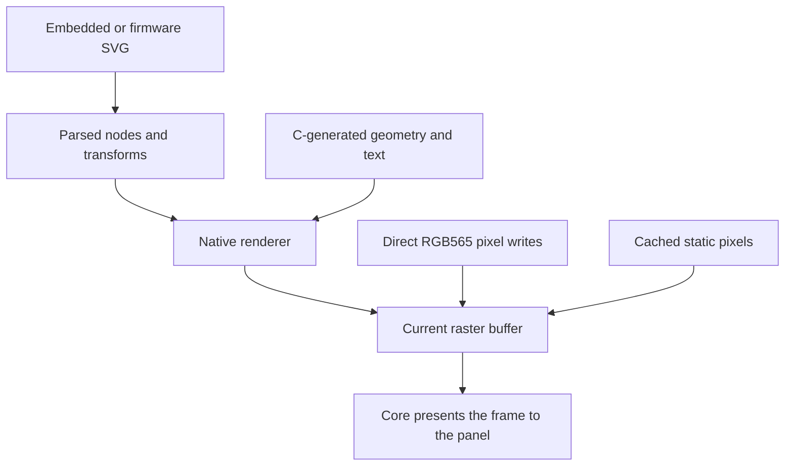

# Designing original OP-1 plug-in interfaces

Technical guidance for the Hundekraft / kennel SDK, based on the local source snapshots inspected on **2026-11-21**.

This guide covers the original OP-1 running compatible modified R246 firmware. It is not an OP-1 Field API specification. The available code contains SDK wrappers and hooks into TE's firmware, not the complete original renderer source. Firmware addresses and private structures are version-specific.

The recommended starting point is **SVG for prepared illustrations, native drawing helpers for changing information, and no explicit caching until the uncached screen is correct**. Use direct pixels when the visual effect warrants the additional implementation work.

## 1. The rendering model

A screen can use three rendering mechanisms:

- **S — SVG:** prepared vector artwork, optionally animated by changing individual nodes.
- **G — generated geometry:** C code calls native raster/text helpers to draw lines, labels, meters and other shapes.
- **P — pixel writes:** C code writes RGB565 values directly into the current raster buffer.

These are composable drawing mechanisms, not separate display modes. Static versus animated is a second distinction: SVG nodes can animate, and code-generated geometry can be completely static. Caching is a third, independent choice.



The core normally prepares the drawing buffer, updates visible screens, flushes the appropriate memory and presents the result. Plug-ins draw into the buffer supplied for that update; they should not independently toggle buffers or present the display. Region caching and frame skipping can change which buffer receives drawing, so do not assume that every update writes directly to the physical display's next frame. See [the frame implementation][gfx] and [frame skipping][guiskip].

## 2. Choose a rendering approach

The following table covers all seven nonempty combinations of S, G and P. **Observed** means a concrete example was inspected. **Composition option** means the mechanisms permit the design, but this investigation did not establish a specific shipped example of that exact combination. A pixel cache underneath SVG does not make the plug-in itself a direct-pixel implementation.

| Combination | Use when | Advantages | Costs and limitations | Evidence/status |
| --- | --- | --- | --- | --- |
| S only | The UI is an illustration with moving needles, indicators or groups. | Editable artwork; named parts; native transforms, rendering and color handling. | SVG subset and path complexity limits; parsed-tree memory; dynamic data may become awkward to represent as many nodes. | Supported by the screen/node API. This is an artwork-only design option, not a claim that every existing SVG screen uses no procedural overlays. |
| G only | The UI is a grid, graph, waveform, face or parameter display driven by data. | Geometry follows data directly; small or empty SVG; easy to generate repeated structures. | Every curve, layout and bound must be implemented; many segments can cost CPU; text and panel alignment need care. | **Observed:** Mouth and Pattern+. |
| P only | The screen is a particle effect, custom software renderer or other dense pixel scene. | Complete pixel control; custom shading and drawing algorithms; no SVG geometry required. | Manual coordinates, clipping, color packing and invalidation; more responsibility for panel differences and performance. | **Observed:** the `soon.c` demo uses an empty SVG and direct pixel rendering. |
| S + G | An illustrated instrument also needs readouts, meters, waveforms or particles. | Strong separation between artwork and data; flexible animation; easy incremental development. | Maintain shared coordinates and paint order; moving SVG must stay out of immutable caches. | **Observed:** Ratatoskr and Iter Lab. Recommended default. |
| S + P | A prepared illustration surrounds a custom pixel viewport. | Artists retain control of the frame; custom raster effects remain possible inside it. | Convert logical coordinates to the panel layout; hash pixel changes; ensure the pixel viewport does not overwrite the artwork unintentionally. | **Composition option.** |
| G + P | A custom pixel visualization needs native text, borders, axes or controls. | Pixel control for the visualization with reusable text/line helpers for the interface. | Two coordinate/color paths; explicit paint order and pixel hashing; test transitions between them. | **Composition option.** |
| S + G + P | A detailed illustrated screen also needs live instrumentation and a specialized pixel effect. | Maximum flexibility; each part uses the most suitable mechanism. | Highest integration and maintenance cost; three paths must agree on layout, clipping, state and redraw. | **Composition option.** Adopt only if a simpler combination is inadequate. |

### Concrete examples

- **Ratatoskr:** `rt_screen_init()` finds the `eagle`, `dragon` and `squirrel` SVG nodes. `rt_screen_update()` positions them, calls `op1_screen_draw()`, then draws the sample-derived trunk, grain indicators and labels. [Source][ratatoskr]
- **Mouth:** `mouth.svg` is empty. `fm_screen_update()` and helpers such as `draw_mouth()` construct the screen in C. [Source][mouth]
- **Pattern+:** `pp_draw_grid()`, `pp_draw_notes()`, `pp_draw_arrow()` and other helpers generate its interface. [Source][patternplus]
- **Iter Lab:** `lab_init()` resolves `bar0` through `bar3`; `lab_update()` rotates those SVG gauges, renders the SVG and adds procedural dots, bubbles and digit segments. [Source][iterlab]
- **Demo:** `sn_update()` in `soon.c` acquires the raster and panel geometry, hashes animation state and renders sphere, knot and terrain scenes through its own pixel routines. [Source][soon]

## 3. Register and package a screen

A synth plug-in manifest can include:

```json
{
  "screen": {
    "svg": "my_synth.svg",
    "symbol": "SCREEN_my_synth"
  }
}
```

This is a manifest fragment, not a complete plug-in manifest. Keep the engine descriptor, source list, defaults and other required fields from the appropriate SDK template.

The corresponding descriptor is:

```c
typedef struct {
    void (*init)(void *scr);
    void (*update)(void *scr, int dt);
} op1_screen_t;
```

For file plug-ins, the packer embeds the SVG text before the aligned KNPL header. The `.knl` also contains compiled code, data, relocations, imports and metadata. The player installs the package; a separate artwork upload is not necessary. Firmware-built screens can instead refer to assets under `content/display`.

The inspected guide recommends **less than 8 KiB of SVG artwork**. This is a project design target, not the native format's universal maximum. The guide records a **1 MiB whole-file limit on cores from 2026-10-21**, versus 512 KiB on older cores. Runtime memory includes parsed artwork, BSS and allocations, so compressed file size alone is not a sufficient budget. [Packaging guidance][plugin-guide]

Keep using the SDK and packer that match the installed core. Missing imported functions or unsupported descriptor flags can cause the loader to refuse a plug-in; a helper's existence in a newer header does not establish compatibility with older firmware.

## 4. Screen lifecycle and ownership

### `init()` is a document-initialization callback, not necessarily a once-per-boot callback

Resolve SVG IDs here with `op1_find_node(scr, "id")`, and check for null before using the result.

The current implementation in `kn_screens.c` loads eligible SVG documents on demand, records their memory cost and evicts older documents under a **400 KiB resident-document target**. This is not a hard upper bound on every frame: documents needed for current/recent screens are protected and loading occurs before eviction. When a document is reloaded, `init()` runs again.

Consequently:

1. Reacquire **every document-owned node or style pointer** on every `init()` call.
2. Separate document initialization from one-time initialization of text objects, lookup tables and persistent UI storage.
3. Do not repeatedly allocate those persistent objects simply because the SVG was reloaded.
4. Do not access node pointers from audio or input callbacks. Keep document mutation on the graphics thread.
5. Leave document destruction, drawing-cache retirement and buffer ownership to the core.

Some general documentation still says parsed documents live until reboot. For lazy screens, the actual `parse()`, `release()` and `lazy_evict()` implementation is the more specific contract. Screen objects and parsed documents have different lifetimes. [Implementation][screens], [lazy-loading design][lazy]

### `update()` advances state and draws

Use `dt` or a suitable clock for time-based animation. In this firmware path, the source describes `dt` as elapsed audio blocks of 64 samples; at 44.1 kHz:

```text
elapsed_seconds = dt * 64 / 44100
```

This is a convention of the inspected R246 path, not a portable SDK-wide millisecond unit. The frame governor can skip updates and accumulate elapsed ticks, with a clamp. Avoid animations whose intended speed assumes a fixed number of calls per second. Some existing examples increment frame counters; those examples should not be copied as a guarantee of timing independence. [Demo timing][soon], [governor][gfx]

## 5. Coordinates, colors and layout

### Logical coordinates

Design in a **320 × 160 logical coordinate space**. Most C geometry helpers use **Q10 fixed point**:

```c
OP1_Q10(10)      /* 10 logical units, represented as 10240 */
OP1_Q10(10.5)    /* constant expression: 10752 */
```

Do not pass `10` where a helper expects `10240`. Check individual signatures: not every argument uses the same units. For example, the native text constructor takes x in Q10 but y in ordinary pixels; line endpoints and transform values have their own fixed-point contracts.

### Panel differences

The logical canvas is not a promise of a 320 × 160 physical pixel array. The inspected API handles scales of `0x500`, `0x4B3` and `0x400` in Q10. Use `op1_dev_scale()` and `op1_dev_xoff()` for grid-aware geometry, and `op1_panel_rows()` for direct-pixel layout. Do not hard-code the default panel's 1.25 scale into general plug-in drawing. [Panel API][api]

For sharp straight lines and small text, use the existing snapping helpers in `seq/seq_text.h`. `sq_linemin()` accepts logical Q10 coordinates and a minimum device-pixel stroke width. `sq_line()` uses a two-pixel minimum; that can be heavier than desired for a dense UI. Smooth moving curves may instead benefit from unsnapped native strokes. [Helpers][seq-text]

### Bounds and paint order

- Keep art and all animation extrema inside a deliberate safe area. The demo uses x 2–318 and y 3–138 for its own composition; this is a useful example, not a universal screen crop.
- The SDK guide records a 12-unit upward correction for established effect-screen layouts. Apply it only when following those layouts; do not shift every new screen or apply it twice.
- Move static art, generated geometry, text, pivot positions and clipping together when adjusting a composition.
- Bound coordinates before submitting them. Existing project code specifically guards against far-offscreen geometry causing excessive native rasterizer allocation.
- Draw order is compositing order. SVG first followed by a waveform puts the waveform over the SVG. If a bezel must cover the waveform, draw that foreground after it or restructure the layers.
- A dynamic-region declaration is not a clipping rectangle. You remain responsible for keeping drawing inside it.

Prefer familiar encoder colors, but also provide labels, units and active-page indicators. A hidden secondary control is difficult to learn even if its animation is attractive.

## 6. SVG artwork: supported patterns and traps

Use simple groups, lines, circles, polylines and paths. The project's conservative authoring vocabulary is **M/L/C/Z paths and matrix transforms**. The inspected validator documents additional native path commands **H/V/S**, but avoid relying on broader browser SVG support.

| Issue | Guidance |
| --- | --- |
| Quadratic curves and arcs | Convert Q/T and A paths to supported cubic or line geometry before packaging. |
| Numeric formatting | Emit no more than four decimal places; avoid scientific-notation output. The validator documents parser failures on unsupported syntax. |
| Compound filled paths | Keep separate filled contours in separate paths. Subsequent move commands can be interpreted as connecting lines, creating unwanted triangles. |
| Very long paths | Split geometry. `svg_lite.py` uses a 256-vertex budget for its bridged-fill conversion; this is a conservative tool policy, not a universal firmware limit. |
| Repeated points and near reversals | Remove zero-length segments and near-180-degree turnbacks; the native stroke renderer can produce spikes that a browser does not show. |
| CSS, browser fonts and opacity | Do not depend on them. Use explicit supported paint and native text/stroke helpers. |
| Moving parts | Assign stable IDs. Preserve IDs, grouping, paint order and transforms when optimizing assets. |
| Browser preview | Useful for composition, insufficient for native parser or rasterizer validation. |

Functions used for artwork animation include:

```c
op1_find_node(scr, "needle");
op1_node_set_visible(node, visible);
op1_node_set_transform(node, matrix_q10);
op1_node_rotate(node, pivot_x_q10, pivot_y_q10, sin_q15, cos_q15);
op1_node_line_rgba(scr, "outline");
op1_node_fill_rgba(scr, "body");
op1_screen_draw(scr, dt);
```

Treat returned color/style pointers as document-owned too. A cached static node must not be transformed, recolored or hidden later.

Sources: [artwork guide][screen-art], [SVG validator][svg-check], [conversion tools][svg-lite], [screen API][api].

### Starting with a PNG or other bitmap

There is no general native PNG/JPEG loading path established by this source review. Options are:

| Approach | Advantages | Disadvantages |
| --- | --- | --- |
| Trace line-art PNG to SVG before building | Uses the normal screen asset pipeline; resulting groups can be animated; suits OP-1-style line art. | Tracing needs cleanup; shaded or photographic art can become too complex. |
| Convert pixel art to supported filled paths | Preserves a deliberately limited pixel-art design without a bitmap decoder. | Many contours increase parsing and rendering cost; inspect the native result. |
| Convert bitmap to packed pixel data at build time | Preserves raster artwork; no device-side PNG decoder needed. | Adds data/storage and custom blitting; must implement scaling, clipping and any transparency convention. |
| Add an image decoder | Could support an actual encoded image format. | New implementation scope, dependencies, memory and CPU costs; not a verified stock SDK feature. |

`display/art_trace.py` implements the first option. `display/pixel_svg.py` generates rectangle covers or bridged color contours for pixel art. RGB565 caching of already-rendered SVG is a separate optimization; it is not PNG support. Workshop thumbnails under `cards/` and `manual/img/` are browser assets. [Trace tool][art-trace], [pixel-art converter][pixel-svg]

## 7. Generated geometry and text

Use `op1_raster()` to obtain the current raster and `op1_raster_line()` for native line drawing. Build curves from bounded segments when appropriate; use existing circle/ring/ellipse helpers from an example instead of inventing inconsistent coordinate conventions.

Text has two established routes:

| Route | Mechanism | Advantages | Tradeoffs |
| --- | --- | --- | --- |
| Native firmware text | `op1_text_ctor()`, `op1_text_set()`, `op1_text_draw()` | Matches firmware typography; used by Mouth and Ratatoskr. | Version-specific wrappers in the private `op1_synth.h`; allocate object storage correctly and construct once. x/y units differ. Verify SDK/export compatibility before adopting private helpers. |
| Shared stroke text | `sq_text()` and helpers from `seq/seq_text.h` | Explicit geometry, reusable shared implementation and panel-aware strokes. | Limited glyph set and style; unknown characters leave gaps. Measure longest labels and numeric values. |

The native text object size in this snapshot is `OP1_TEXT_SIZE = 0xA4`. Existing code keeps object storage across frames and only calls `op1_text_set()` when the string changes. Do not reconstruct text objects on every update or every lazy SVG reload. [Native text wrappers][synth-header], [Mouth's text handling][mouth], [stroke text][seq-text]

### Show the state the player is actually editing

- Synth screens should normally read `op1_synth_knobs_live(OP1_SCREEN_SLOT, values)` for modulation-aware display.
- FX screens should normally read `op1_fx_knobs_live(values)`; raw FX words have different ranges and are not universally 0–32767.
- Use the displayed slot/FX position, not an assumed fixed instrument slot. `op1_fx_screen_pos()` distinguishes synth, drum and master FX contexts.
- For a saved-value readout, intentionally use the saved words and distinguish that from live modulation where useful.
- A page-two or Shift control should show its current name, value and units, not merely move an unexplained shape.
- Discrete controls can use `op1_engine_knob_steps()`; Shift controls have helpers such as `op1_engine_shift()` and `op1_engine_shift_record()`. Check their core requirements and initialize them in the documented context.

The screen receives `init`/`update`; input registration is a separate API concern. Do not treat drawing callbacks as arbitrary key handlers. Dedicated T2/T4 pages also require the relevant extension descriptors and flags; attaching a T1 SVG alone does not register those pages. [API][api]

## 8. Direct pixel rendering

Use this route for effects where custom pixel work is justified, not simply to avoid learning the SVG subset.

The inspected R246 raster object is described as four words:

```text
{ pixel_address, columns, bytes_per_row, rows }
```

Pixels are RGB565. A conventional conversion from 8-bit RGB components is:

```c
uint16_t rgb565(unsigned r, unsigned g, unsigned b)
{
    return (uint16_t)(((r & 0xF8u) << 8)
                    | ((g & 0xFCu) << 3)
                    |  (b >> 3));
}
```

This representation has no alpha channel. A custom sprite system must define transparent pixels, masks or blending itself; do not assume an RGBA bitmap can be copied directly.

The panel is stored rotated relative to screen coordinates. For **device-pixel coordinates** in a page laid out according to `op1_panel_rows(raster)`, the header specifies:

```text
pixels[(panel_rows - 1 - x) * 256 + y]
```

The inspected stride is 512 bytes, or 256 RGB565 pixels. This is not an indexing formula for 320 × 160 logical coordinates. Convert to the panel's pixel grid, apply your bounds and margins, and verify the raster layout first. `raster.rows` alone can be misleading on some panel variants; use `op1_panel_rows()`.

A raw bitmap/blitter design should specify, explicitly:

1. Source dimensions, packing and transparency convention.
2. Logical destination rectangle and scale policy.
3. Destination panel mapping and stride.
4. Clipping before any memory write.
5. Paint order relative to native graphics.
6. Which state values invalidate the displayed pixels.
7. Whether it reads back or caches pixels, and when those pixels are valid.

### Frame skipping is part of correctness

The core hashes supported native drawing operations. Direct memory writes bypass that mechanism. Feed every state component that can change your pixel output through `op1_screen_hash(scr, value)`, or combine them into a stable revision/hash that changes with the image.

Do this in both record and render updates. For example, hash phase, selected page, palette selection and any data revision affecting a custom graph. Hashing a constant will freeze changes; hashing an incrementing counter defeats idle-frame savings when the picture is actually unchanged.

Use `op1_raster_live(raster)` before capturing pixels into a reusable cache. A record frame can point at scratch memory that is neither cleared nor presented. Reading that memory as if it contained the rendered background produces a corrupt cache.

`op1_screen_redraw()` requests the next two frames to render, covering both display buffers. It is useful for explicit invalidation; calling it continuously is not a substitute for a correct hash. [API][api], [frame-skip implementation][guiskip], [pixel example][soon]

## 9. Caching and redraw choices

### Available mechanisms

| Mechanism | Best fit | Advantages | Costs / conditions |
| --- | --- | --- | --- |
| Ordinary native drawing | First implementation; modest geometry; highly dynamic screens. | Simplest paint order and lifetime model; no explicit cache contract. | Repeated visible changes still require rendering. Core frame skipping can nevertheless avoid unchanged frames. |
| Static SVG-prefix cache | Expensive immutable background followed by mutable artwork/overlays. | Preserves native-rendered pixels and avoids repeating static rasterization. | Strict immutable prefix; bounded shared memory; panel/arena-dependent fallback. |
| Static procedural drawing in prefix cache | Complex fixed geometry generated in C. | Avoids redrawing generated static art; works with an empty SVG. | Extra callback must stay immutable and respect fallback paint order. |
| Static/dynamic regions | A mostly fixed screen with small changing rectangles. | Restores only changing areas after the static image is established. | Must declare all dynamic bounds and explicitly invalidate static changes; shared memory cost and eligibility restrictions. |
| Plug-in-owned pixel cache | A specialized renderer not served by the above. | Custom format and control. | Plug-in owns memory, invalidation, panel compatibility, hashing and correct capture timing. No generic bitmap cache API is established here. |

### Static-prefix cache

Call:

```c
op1_screen_draw_cached(scr, dt, first_live);
```

`first_live` is the first **top-level** SVG child after an immutable, always-visible prefix. Pass null only if the entire SVG is immutable. A node nested inside a group is not the correct boundary.

The prefix must be drawn first onto the cleared raster. Keep mutable colors, visibility, transforms and labels after the boundary. This cache is not appropriate for arbitrarily interleaved static and moving layers.

The implementation uses two shared **96 KiB** records, with an allocation check preserving **64 KiB** of arena headroom. These are shared resources, not a private budget per plug-in. It falls back to ordinary drawing if unavailable or unsuitable. In this snapshot, its checks deliberately restrict the optimized path to the supported default-panel raster conditions; test other panels on the fallback path.

JUNI and Wavetable pass null because their SVGs are entirely still. HAIL, MBIRA and PLOC show mutable-boundary designs. Resolve the boundary again on every document initialization. If lookup fails, use `op1_screen_draw()`; do not accidentally pass null and cache moving artwork as static. [Implementation][artcache]

### Cache fixed C drawing too

Immediately before the cached draw:

```c
op1_screen_cached_extra(draw_fixed_details);
op1_screen_draw_cached(scr, dt, first_live);
```

The extra callback applies to the next cached draw only. On a cache miss, it joins the static prefix's captured pixels. Without caching, it runs after the ordinary SVG draw. Therefore it must not overlap the mutable suffix in a way that changes the intended layering between those two paths.

**Observed combinations:** Ludwig caches procedural static artwork with an empty SVG; Stutter caches its static artwork and generated knob faces, draws a rotating SVG reel as the suffix, then draws changing rings/readouts. [Ludwig][ludwig], [Stutter][stutter]

### Static/dynamic region cache

The API pattern is:

```c
/* Illustrative structure: draw_static/draw_dynamic are your functions. */
static const op1_rect_t dynamic_areas[] = {
    { 20, 30, 290, 100 },
    {  8, 120, 310, 140 }
};

op1_screen_regions(scr, dynamic_areas, 2);
if (op1_screen_static(scr)) {
    draw_static(scr, dt);
    op1_screen_static_done(scr);
}
draw_dynamic(scr, dt);
```

Rectangles use integer logical coordinates with inclusive bounds. `OP1_REGIONS_MAX` is 16. Every changing stroke, antialiased edge, label and animation extreme must fit the declared areas. The API does not clip drawing for you.

Call `op1_screen_static_dirty(scr)` when the static part changes, such as a label set or page layout. The current implementation allocates about **200 KiB** for this cache only when a loaded file imports the region API and memory permits. The optimization also checks that the registered screen is the sole visible screen; overlays and unsuitable conditions can cause ordinary rendering instead.

The inspected SDK supplies the mechanism, but this review did not find a concrete plug-in calling it in the searched C sources outside the core. Treat it as a supported advanced option requiring its own native validation. [API][api], [implementation][guiskip]

### Which combinations of caching are sensible?

| Combination | Guidance |
| --- | --- |
| Ordinary rendering + automatic frame skipping | Default. Native calls are tracked automatically; direct pixels still need a hash. |
| Prefix cache + automatic frame skipping | Implemented integration: the cache hashes its restored content and handles record frames. |
| Prefix cache + static-extra callback + changing overlays | Observed in the sources. Respect immutable content and fallback ordering. |
| Region cache + automatic frame skipping | Implemented together in `guiskip.c`. Follow the static/dynamic API protocol. |
| Region cache + direct pixels | Design option. Hash dynamic pixel state and keep writes within declared areas; validate scratch/cache-buffer interactions. |
| Prefix cache + region cache on the same screen | Not established by the inspected examples. Both manage background restoration and frame targets; do not stack them merely because both APIs exist. Pick one first, and prove correctness and benefit before combining. |
| Any cache + plug-in-owned pixel cache | Possible additional implementation work, but generally redundant unless it serves a different layer. Budget every buffer and document ownership explicitly. |
| Frame governor + any of the above | Orthogonal scheduling mechanism. It can reduce update frequency; animation must tolerate variable `dt`. |

## 10. A small SVG-plus-geometry screen skeleton

This is an illustrative synth-screen fragment, not a complete build-tested plug-in. It assumes the matching SDK, an SVG with optional node `activity`, and normal manifest/engine registration. The visible artwork node deliberately remains outside any explicit cache.

```c
#include "op1_plugin.h"

static void *activity;
static const uint8_t blue[4] = { 0x4D, 0x9E, 0xFF, 0xFF };

static void ui_init(void *scr)
{
    /* Reacquire on every SVG load, including after eviction. */
    activity = op1_find_node(scr, "activity");
}

static void ui_update(void *scr, int dt)
{
    int16_t knobs[4];
    op1_synth_knobs_live(OP1_SCREEN_SLOT, knobs);
    int value = knobs[0];
    if (value < 0) value = 0;

    if (activity)
        op1_node_set_visible(activity, value > 0);

    /* First the artwork; then the generated overlay. */
    op1_screen_draw(scr, dt);
    void *raster = op1_raster();

    int32_t length = (int32_t)((int64_t)value * OP1_Q10(120) / 32767);
    if (length > 0) {
        op1_pt start = { OP1_Q10(20), OP1_Q10(100) };
        op1_pt end = { start.x + length, start.y };
        op1_raster_line(raster, &start, &end, OP1_Q10(2), blue);
    }
}

const op1_screen_t SCREEN_my_synth = { ui_init, ui_update };
```

This uses native drawing operations, so it does not need a custom pixel hash. For a crisper axis-aligned bar, adapt the line call to `sq_linemin()`. For an FX screen, use the FX live-value helper and registration appropriate to that plug-in kind.

## 11. Performance and thread discipline

- Draw and manipulate SVG/text objects on the graphics thread. Audio callbacks should publish compact display state, not render or parse assets.
- Read a coherent snapshot of values before drawing. `volatile` alone does not make a multi-field snapshot atomic; use an appropriate bounded handoff if consistency matters.
- Avoid per-frame allocations, file I/O, unbounded geometry and repeated text construction. Keep fixed-point calculations bounded; promote intermediate products when overflow is possible.
- Use `OP1_SINE_TABLE` directly for screen trigonometry as documented. The guide warns against calling the audio-side lazy sine helpers from screens because initialization can race audio execution.
- Use `op1_gfx_heavy()` to reduce optional particles or detail while the core governor is active. The current `KN_GOV_MAX_LEVEL` is 1, giving a 15 fps governor floor; generic API comments also describe a possible level 2. Do not mistake that comment for the active configuration.
- Preserve readable values and input feedback when reducing animation. The display's decorative motion should not consume the budget needed for audio or basic interaction.

The snapshot also contains panel pacing logic that can select 30, 20 or 15 fps under its supported conditions. Do not promise a fixed UI frame rate merely from the panel refresh rate. [Frame governor and pacing][gfx], [configuration][gfx-header], [thread guidance][plugin-guide]

## 12. Validation workflow

1. **Start uncached.** Verify static composition, labels, control mappings and live values first.
2. **Validate SVG syntax.** From a matching SDK checkout, the checker supports `python synth_sdk/harness/svg_check.py PATH_TO_PLUGIN_DIRECTORY`. This checks known constraints, not all native rendering behavior.
3. **Exercise the state space.** Capture minimum/default/maximum values, every discrete choice, secondary controls, Shift states, silence, active voices, long labels and missing sample/data states.
4. **Check native output.** Browser previews and host rendering can miss native join spikes, unsupported syntax, clipping and allocation failures. Inspect emulator/native captures and the physical OLED where available.
5. **Check panel variants.** Exercise the supported scales, grid snapping, margins, raw-pixel mapping and cache fallbacks.
6. **Check lifecycle.** Enter and leave the screen repeatedly; visit enough other screens to exercise lazy eviction; verify node reacquisition and stable memory use.
7. **Check redraw.** Leave the screen idle, then change one parameter. Direct pixel content must update after idle record frames. Look for ghosting on both buffers.
8. **Add one optimization at a time.** Compare cached and uncached output, including overlays, page changes and unavailable-cache conditions. Measure memory and graphics cost rather than assuming a cache helps.
9. **Stress audio concurrently.** Test the UI while its actual engine/effects are busy. Ensure optional visual load backs off and animation timing remains sensible.

OP-1 Mirror is useful for viewing and recording the final device pixels. It streams rendered screen content rather than recreating the UI from parameters. It helps inspect results but does not replace physical OLED visibility checks. [Mirror overview][mirror]

## 13. Troubleshooting by symptom

| Symptom | Likely areas to inspect |
| --- | --- |
| SVG looks right in a browser but fails or corrupts on-device | Unsupported commands, numeric precision, compound fills, turnbacks, path complexity. |
| Animation freezes after an idle period | Direct pixel writes omitted from the frame hash, or changing artwork was placed in an immutable prefix. |
| Trails remain behind a moving element | Incomplete dynamic regions, missing background restoration, or dependence on stale framebuffer contents. |
| Screen breaks after visiting several other plug-ins | Stale SVG node/style pointers after lazy eviction; repeated allocations in `init()`. |
| Cached and uncached screens differ | Mutable prefix, wrong top-level boundary, or static-extra callback overlapping the live suffix. |
| Text or lines are blurry on another OP-1 | Hard-coded device scale, mixed units or missing panel-grid snapping. |
| Direct image is rotated, shifted or partly missing | Logical/device coordinate confusion, wrong stride, use of raster rows instead of panel layout. |
| UI state differs from what is heard | Saved values used where live modulation was intended; wrong slot or FX position. |
| Animation speed changes under load | Frame-count-based motion rather than elapsed-time-based motion. |
| Optional helper causes installation refusal | Core does not export the imported function or support the descriptor flag. |

## 14. Source map and evidence boundaries

Local source links below assume this guide remains in `op-1-tools/research` and the two reference repositories remain sibling directories under `D:/src`. They point to the inspected working-tree files, not immutable release permalinks. Recheck the matching SDK before using this guide with a later core.

| Source | Main purpose |
| --- | --- |
| [Plug-in guide][plugin-guide] | Packaging, threading, artwork constraints and API compatibility. |
| [Public plug-in API][api] | Screen callbacks, node operations, coordinates, pixel access, caching and controls. |
| [Native screen guide][screen-art] | Supported artwork and composition rules. |
| [Screen manager][screens] / [lazy design][lazy] | Document loading, eviction, reinitialization and frame ownership. |
| [Static-art cache][artcache] | Exact prefix cache behavior and fallback conditions. |
| [Frame skip / regions][guiskip] | Draw hashing, record frames, region restoration and eligibility. |
| [Frame governor][gfx] / [constants][gfx-header] | Pacing, skipped updates and audio-load response. |
| [Native text wrappers][synth-header] / [stroke helpers][seq-text] | The two text approaches and unit conventions. |
| [SVG checker][svg-check] / [SVG simplifier][svg-lite] | Known parser and geometry constraints. |
| [PNG tracing][art-trace] / [pixel-art SVG][pixel-svg] | Build-time artwork conversion. |
| [Ratatoskr][ratatoskr], [Mouth][mouth], [Pattern+][patternplus] | Project-local implementations. |
| [Iter Lab][iterlab], [demo][soon], [Ludwig][ludwig], [Stutter][stutter] | Mixed rendering, pixels and static-cache examples. |

This guide documents source behavior and engineering recommendations. It does not claim that its illustrative snippets or every proposed combination were built or exercised on hardware. In particular, general image decoding, triple-mechanism composition and stacking background-cache systems need implementation-specific verification.

[plugin-guide]: ../../hundekraft-source/PLUGIN_GUIDE.md
[api]: ../../hundekraft-source/ext/kennel/synth_sdk/op1_plugin.h
[synth-header]: ../../hundekraft-source/ext/kennel/synth_sdk/op1_synth.h
[seq-text]: ../../hundekraft-source/ext/kennel/synth_sdk/seq/seq_text.h
[screen-art]: ../../hundekraft-source/ext/kennel/docs/screen-art.md
[screens]: ../../hundekraft-source/ext/kennel/synth_sdk/kennel/kn_screens.c
[lazy]: ../../hundekraft-source/ext/kennel/docs/svg-lazy.md
[artcache]: ../../hundekraft-source/ext/kennel/synth_sdk/kennel/kn_artcache.c
[guiskip]: ../../hundekraft-source/ext/kennel/synth_sdk/screens/guiskip.c
[gfx]: ../../hundekraft-source/ext/kennel/synth_sdk/kennel/kn_gfx.c
[gfx-header]: ../../hundekraft-source/ext/kennel/synth_sdk/kennel/kn_gfx.h
[svg-check]: ../../hundekraft-source/ext/kennel/synth_sdk/harness/svg_check.py
[svg-lite]: ../../hundekraft-source/ext/kennel/synth_sdk/display/svg_lite.py
[art-trace]: ../../hundekraft-source/ext/kennel/synth_sdk/display/art_trace.py
[pixel-svg]: ../../hundekraft-source/ext/kennel/synth_sdk/display/pixel_svg.py
[ratatoskr]: ../ratatoskr/plugin/ratatoskr.c
[mouth]: ../mouth/plugin/mouth.c
[patternplus]: ../patternplus/plugin/patternplus.c
[iterlab]: ../../hundekraft-source/ext/kennel/synth_sdk/screens/iterlab.c
[soon]: ../../hundekraft-source/ext/kennel/synth_sdk/screens/soon.c
[ludwig]: ../../hundekraft-source/ext/kennel/synth_sdk/plugins/ludwig/ludwig_screen.c
[stutter]: ../../hundekraft-source/ext/kennel/synth_sdk/plugins/stutter/stutter.c
[mirror]: ../mirror/README.md
